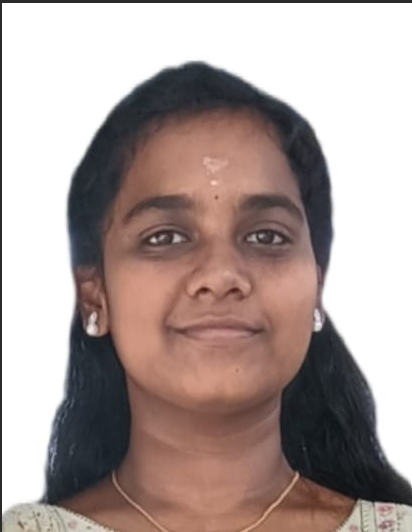
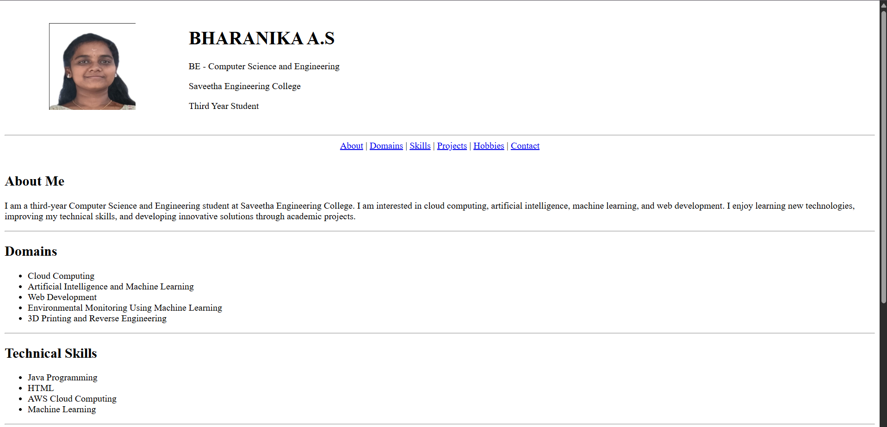
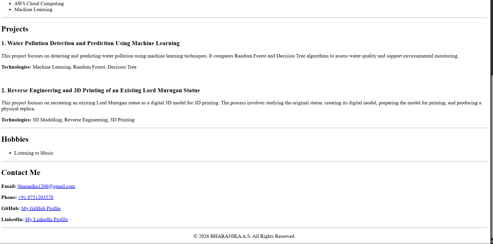

# Ex01 Portfolio
## Date:

## AIM
To create a Portfolio using HTML and CSS.

## ALGORITHM
### STEP 1
Create an HTML file (index.html)

### STEP 2
Create a CSS file (style.css)

### STEP 3
Include a navigation bar with links to different sections.

### STEP 4
Add structured sections for introduction, about, projects, and contact details.

### STEP 5
Define global styles for fonts, colors, and layout.

### STEP 6
Style the header, navigation bar, and sections.

### STEP 7
Use Flexbox or CSS Grid for layout design.

### STEP 8
Add hover effects and transitions for interactivity.

### STEP 9
Add Images and Media.

### STEP 10
Use optimized images for a professional look.

### STEP 11
Open the HTML file in a browser to check layout and functionality.

### STEP 12
Fix styling issues and refine content placement.

### STEP 13
Deploy the Portfolio.

### STEP 14
Upload to GitHub Pages for free hosting.

## PROGRAM

```html

<!DOCTYPE html>
<html lang="en">

<head>
    <meta charset="UTF-8">
    <meta name="viewport" content="width=device-width, initial-scale=1.0">
    <title>Bharanika A.S - Portfolio</title>
</head>

<body bgcolor="white" text="black">

    <header>
        <table width="100%" cellpadding="15">
            <tr>
                <td width="20%" align="center">
                    
                </td>

                <td>
                    <h1>BHARANIKA A.S</h1>
                    <p>BE - Computer Science and Engineering</p>
                    <p>Saveetha Engineering College</p>
                    <p>Third Year Student</p>
                </td>
            </tr>
        </table>

        <hr>
    </header>

    <nav>
        <center>
            <a href="#about">About</a> |
            <a href="#domains">Domains</a> |
            <a href="#skills">Skills</a> |
            <a href="#projects">Projects</a> |
            <a href="#hobbies">Hobbies</a> |
            <a href="#contact">Contact</a>
        </center>
    </nav>

    <br>

    <section id="about">
        <h2>About Me</h2>

        <p>
            I am a third-year Computer Science and Engineering student
            at Saveetha Engineering College. I am interested in cloud
            computing, artificial intelligence, machine learning, and
            web development. I enjoy learning new technologies,
            improving my technical skills, and developing innovative
            solutions through academic projects.
        </p>
    </section>

    <hr>

    <section id="domains">
        <h2>Domains</h2>

        <ul>
            <li>Cloud Computing</li>
            <li>Artificial Intelligence and Machine Learning</li>
            <li>Web Development</li>
            <li>Environmental Monitoring Using Machine Learning</li>
            <li>3D Printing and Reverse Engineering</li>
        </ul>
    </section>

    <hr>

    <section id="skills">
        <h2>Technical Skills</h2>

        <ul>
            <li>Java Programming</li>
            <li>HTML</li>
            <li>AWS Cloud Computing</li>
            <li>Machine Learning</li>
        </ul>
    </section>

    <hr>

    <section id="projects">
        <h2>Projects</h2>

        <h3>1. Water Pollution Detection and Prediction Using Machine Learning</h3>

        <p>
            This project focuses on detecting and predicting water
            pollution using machine learning techniques. It compares
            Random Forest and Decision Tree algorithms to assess
            water quality and support environmental monitoring.
        </p>

        <p>
            <b>Technologies:</b> Machine Learning, Random Forest,
            Decision Tree
        </p>

        <br>

        <h3>2. Reverse Engineering and 3D Printing of an Existing Lord Murugan Statue</h3>

        <p>
            This project focuses on recreating an existing Lord Murugan
            statue as a digital 3D model for 3D printing. The process
            involves studying the original statue, creating its digital
            model, preparing the model for printing, and producing a
            physical replica.
        </p>

        <p>
            <b>Technologies:</b> 3D Modelling, Reverse Engineering,
            3D Printing
        </p>
    </section>

    <hr>

    <section id="hobbies">
        <h2>Hobbies</h2>

        <ul>
            <li>Listening to Music</li>
        </ul>
    </section>

    <hr>

    <section id="contact">
        <h2>Contact Me</h2>

        <p>
            <b>Email:</b>
            <a href="mailto:bharanika1206@gmail.com">
                bharanika1206@gmail.com
            </a>
        </p>

        <p>
            <b>Phone:</b>
            <a href="tel:+919751203578">
                +91 9751203578
            </a>
        </p>

        <p>
            <b>GitHub:</b>
            <a href="https://github.com/Bharanika-arumugam"
               target="_blank" rel="noopener noreferrer">
                My GitHub Profile
            </a>
        </p>

        <p>
            <b>LinkedIn:</b>
            <a href="https://www.linkedin.com/in/bharanika-arumugam-116084322"
               target="_blank" rel="noopener noreferrer">
                My LinkedIn Profile
            </a>
        </p>
    </section>

    <hr>

    <footer>
        <center>
            <p>
                &copy; 2026 BHARANIKA A.S. All Rights Reserved.
            </p>
        </center>
    </footer>

</body>

</html>


```

## OUTPUT

 



## RESULT
The program for creating Portfolio using HTML and CSS is executed successfully.